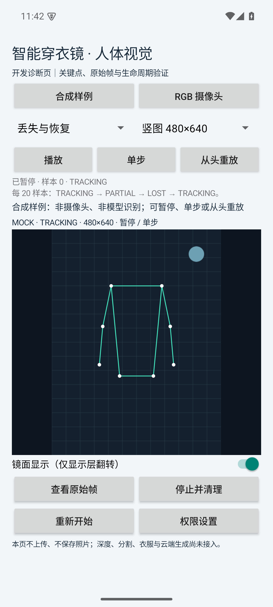

# Android 开发版验证记录

日期：2026-09-26。范围：T01 工程基线、T02 RGB 适配、可控合成场景与开发诊断页。尚未完成企业硬件验收或完整试衣联调。

## 环境与结果

Windows 主机构建，JDK 21.0.10，Gradle 8.11.1，AGP 8.9.2，Android SDK 35。设备测试使用 API 35 / Android 15 的 x86_64 模拟器，配置模拟 RGB 摄像头；没有连接真实手机或企业深度摄像机。

| 检查 | 结果 |
| --- | --- |
| app:assembleDebug | 通过，生成并安装调试 APK |
| core-contracts:test | 14 项通过，含 13 份 JSON 样例双向映射、版本/句柄/跟踪状态校验 |
| core-vision:testDebugUnitTest | 9 项通过，含姿态映射、可重复场景、平移/缩放与跟踪状态切换 |
| app:connectedDebugAndroidTest | 4 项通过，含停止/重建状态、RGB 推理、场景/画幅/暂停恢复、快速切源及旧截图抑制 |
| core-vision:connectedDebugAndroidTest | 6 项通过，含方向、原图无叠加、暂停/单步/定位、横图拍照、关闭和重启后拒绝旧截图及帧释放 |
| app:lintDebug / core-vision:lintDebug | 通过，0 Error；合计 24 个非阻断 Warning，主要涉及固定依赖版本和诊断页样式/国际化/绘制建议 |
| Python 合同检查 | 通过：OpenAPI、两份 Schema、13 样例、五类错误拒绝及本地文档链接 |
| 页面视觉检查 | 已检查竖屏与横屏；竖屏完整显示，横屏使用纵向滚动，保留原图比例 |
| 系统权限手动验证 | API 35 模拟器首次点击 RGB 后拒绝授权，合成样例仍可单步；再次请求并允许使用时授权后，RGB 摄像头恢复输出 |

运行命令见 [Android README](../android/README.md)。本机 Central 域名返回 403，构建时使用文档中的 centralRepositoryUrl 参数；未关闭 TLS。CI 保持默认官方 Central。

设备测试曾发现：停止后重建 Activity，原始帧按钮恢复为可用。已修复按钮初始状态并重新通过测试。低置信度不再直接标记人体出框。审查后补全公共类型校验，并将合成截图压缩移到后台；会话关闭后清理并拒绝尚未返回的截图，相关回归测试已通过。

本轮共 23 项 JVM 测试与 10 项模拟器测试。新增测试实际覆盖：RECOVERY 四阶段；缩放比例和平移不变形；暂停后不继续出帧；单步/定位后 frame_id 仍递增；横图照片编码尺寸；原始拍照未完成时重启会话；READY 回调中立即停止；界面重建保留场景、画幅、暂停选择；快速 RGB/合成切换和停止后不显示旧截图。

手动权限验证使用系统真实权限弹窗，先选择 Don’t allow，再选择 While using the app；拒绝后合成样本可从 445 单步至 446，再授权后画面显示 RGB_CAMERA 输出。该验证只证明授权流程和虚拟 RGB 推理通路，不证明真实人体精度；永久拒绝、厂商权限管理和真实设备兼容性仍需补测。

## 当前可交付

- 公共 DTO、图像坐标与帧所有权接口。
- 合成数据源、普通 RGB 摄像头与本地八点姿态适配。
- 七类合成场景、两种输入画幅、暂停/单步/从头重放与场景状态提示。
- 原始帧查看、权限入口、停止清理、前后台恢复与诊断显示。
- 为两位协作者保留可构建的 core-network / feature-tryon 空模块及接入说明。
- [无设备联调说明](no-device-integration.md) 定义 V01–V08 的输入、预期与职责边界；渲染/网络尚未接入，不能视为端到端已通过。

以下截图是明确标记的合成样例，不是人体识别精度或试衣效果证明：

## 仍需验证

- 在真实手机上验证全身关键点、左右对齐、抬手、转身、不同身高和人物离开。
- 记录真实设备的输出帧率、延迟、内存和发热；模拟器 FPS 不代表企业大屏性能。
- 获取企业设备与 SDK 后验证深度采集、RGB/Depth 对齐和连接恢复；当前 mask/depth 均为空。
- 云端试衣、服装渲染、视频推荐由对应成员实现，当前未接入。
- 8–12 小时稳定性、真实环境遮挡与素材适配仍未验证。

任务应在代码审阅合并、对应证据确认后更新状态，不能因生成了 APK 就把全部企业需求标记完成。
