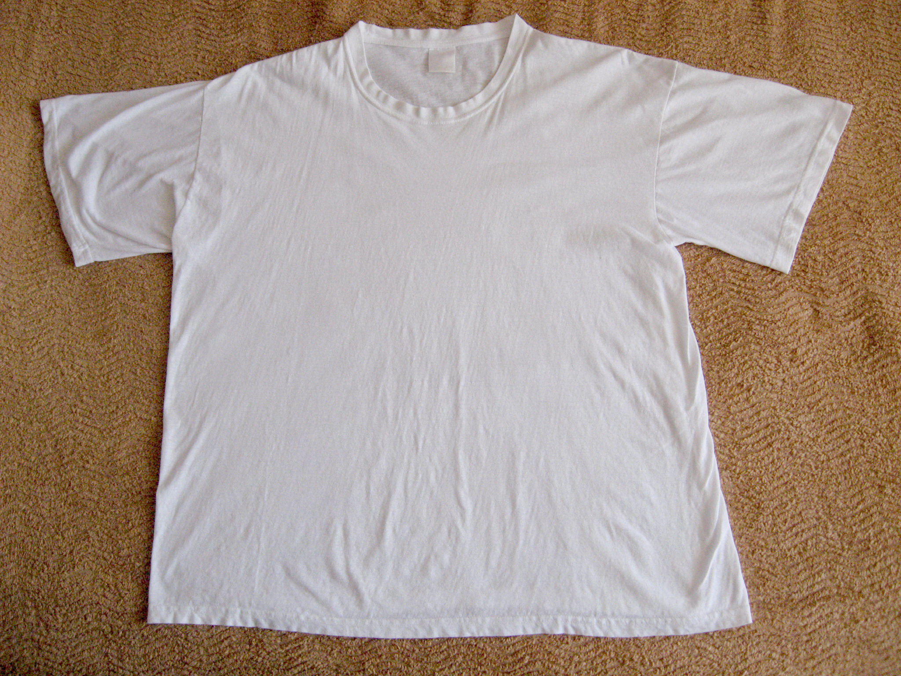

# 本周真实输入素材（2026-10-19）

## 首选服装：真实白色 T 恤照片

- 文件：`white-tshirt-original.jpg`，2048×1536，原始 JPEG，尚未去背景或接入目录。
- 作者：Elkagye；来源：[Wikimedia Commons / T-shirt2.jpg](https://commons.wikimedia.org/wiki/File:T-shirt2.jpg)。
- 来源下载：[原图](https://upload.wikimedia.org/wikipedia/commons/0/0f/T-shirt2.jpg)。
- 许可：来源页标记 PD-self，作者将作品贡献至公有领域；不把该照片错误标成项目原创或 CC0。
- SHA-256：`77f7caa3b19fad9231f777a9d0623a1a4d3fe609a7456c63309f60e65e95c25f`。
- 已查看原图：单件上衣平铺、双袖和下摆完整，能看到真实布料与褶皱，适合本周制作透明素材。地毯和领口背景仍需去除。

lyf-bee 负责去背景、按照片实际比例裁切并检查四锚点；不要用生成式重绘替换衣服纹理。交付到 `backend/assets/real/`，配来源、处理步骤、真实宽高与锚点；haiyangniu191-design 接入目录。当前原图不是已经完成的透明试穿素材。

## 可由负责人提供的自有服装

任选一件真实上衣，正面平铺或挂好，用手机尽量垂直拍摄：衣服完整入镜、袖子展开、背景与衣服颜色有差异、没有手或吊牌遮挡、光线均匀。同时给出名称和使用授权。先做一件，第二件有余力再加，不要求一次上传整个衣柜。

处理只做去背景、必要的旋正和等比缩放，保留实物纹理。记录最终 PNG 尺寸，不能拉成固定 3:4 来“修正”效果。肩/髋锚点按穿着者左右命名；髋点是躯干对齐位置，不直接取下摆角。

## 真人：摄像头为本周实时验收输入

优先普通 Android 手机，使用已有 `CameraRgbSource` 与端侧 ML Kit；一位自愿参与的同学正面站立，使肩部和髋部完整入镜。先在诊断页看关键点，再到试衣页验证同帧衣服跟随。移动、靠近/远离、离开/返回各做一次。现场真人照片或录像留在本机的 `data/private/` 等忽略目录，公开 PR 记录操作、环境与结果即可。

镜子接线未解决时，手机可先验证算法和交互；最终 ZC-3588A 的兼容与性能仍单独验收。模拟器的 `emulated` 相机/虚拟场景不算真人输入。若使用电脑实体摄像头透传，也要实际观察到实时真人并记录来源。

## 静态真人照片：仅辅助识别/对齐

已为负责人本地下载并查看 [Monstera Production / Pexels 6311639](https://www.pexels.com/photo/black-man-holding-t-shirt-standing-against-white-background-6311639/)，原图 5760×3840，单人正面、肩髋可见；双手靠近衣服，仅适合先做静态识别/对齐，不能代表抬臂遮挡或实时跟随。照片依 [Pexels License](https://www.pexels.com/license/) 使用，不作为项目原创或人物代言，也不把图库原图另建公开素材库。

原图 [下载](https://images.pexels.com/photos/6311639/pexels-photo-6311639.jpeg?cs=srgb&dl=pexels-gabby-k-6311639.jpg&fm=jpg)，SHA-256：`3b98aed2f9237d2b26d32c3b48fca619ced2cfcc0a366f9bc220df6bd15f8d69`。文件大于当前服务 1600 万像素上限，使用前在本地等比降采样，保留原图只作输入依据。真人图库照片未提交本仓库。

当前 App 没有导入照片/视频入口；这是后续可用的输入材料，不是现有按钮。若新增照片源，必须对实际像素运行姿态检测，记录真实尺寸与旋转，不能给真人照片配合成关键点；静态照片与实时摄像头分别验收。

## 其余候选的筛选结果

已查看 [Angela Roma / Pexels 7319172](https://www.pexels.com/photo/t-shirt-with-tag-hanging-on-counter-7319172/)（吊牌遮住衣服正中）与 [Deybson Mallony / Pexels 18256097](https://www.pexels.com/photo/t-shirt-on-a-hanger-18256097/)（手持、有明显透视与标识）。它们是实拍，但本周不优先采用，避免让新成员在抠图前先修遮挡和透视。
