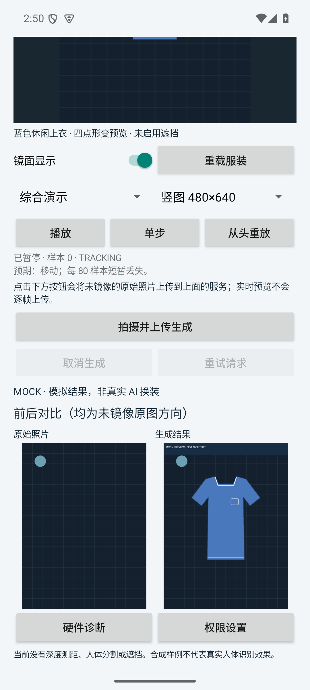
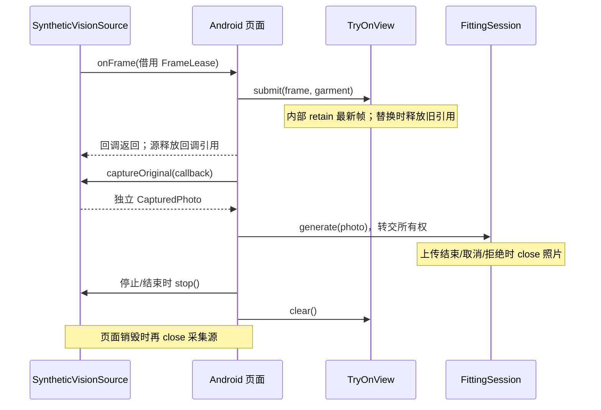

# Miqi9880：无硬件视觉验证与模拟联调记录

日期：2026-10-13（Asia/Shanghai）。对应 [Issue #3](https://github.com/Miqi9880/smart-fitting-mirror/issues/3) 的 10 月 13–18 日任务。

执行者：Miqi9880 委托 Codex 在本机独立操作模拟器、运行检查并核对截图。**个人复现完成，团队共同验收待安排。** 本报告不能替代负责人/成员亲自理解和讲解自己的模块。

## 结论与边界

已有 main 可以独立跑通本地模拟服务、上衣预览、原始照片上传、模拟生成、对比和结束清理；failure → 结束 → 切回 success → 新会话生成也通过。其他成员可以在自己的电脑启动现有后端，不必等待后端同学提供远程服务或真实 AI。

本次新增复现记录、截图和启动交接，没有修改业务代码、依赖或公共接口。未发现阻断本次模拟流程的缺陷，因此不为完成任务额外重构。所有输入都是合成图，所有生成结果均为 MOCK。

**S40 现场验证按计划暂缓，现有未知项保留。** 真人姿态精度、真机 RGB 性能、S40 的开机/系统/安装权限、相机/SDK、深度/遮挡、真实 AI 均未由本次验证证明。Issue #3 是长期功能卡，本周交付不关闭它。

## 版本与实际环境

| 项目 | 本次使用 |
| --- | --- |
| 被验证的软件提交 | `b1b6090d4fab270b0107666395c8f1f8ddd09c25`，开始时与 origin/main 一致 |
| 报告分支 | `docs/owner-no-hardware-20261013` |
| 主机 / Python | Windows；项目独立虚拟环境 Python 3.12.14 |
| Android 工具 | JDK 21.0.10、Gradle Wrapper 8.11.1、AGP 8.9.2、Kotlin 2.1.20 |
| 模拟器 | Android Emulator 37.1.11.0；API 35 / Android 15 / x86_64；1080×2400 |
| App | `0.2.0-mock`，versionCode 2；debug APK |
| 输入 / 服装 | SyntheticVisionSource；480×640 与 640×480；`upper_blue`（蓝色休闲上衣） |
| 服务 | 本机 `127.0.0.1:8000`；模拟器访问 `http://10.0.2.2:8000`；依次 success、failure、success |

模拟器截图状态栏使用设备默认时区，不作为报告的工作时间依据。没有接入实物 S40 或外接摄像头。

## 成员可直接复现的启动步骤

已有环境继续使用。首次配置见 [入门说明](../getting-started.md)：Android Studio 打开 `android`，安装 SDK 35 和 API 35 模拟器，Gradle JDK 选择 17 或 21。后端使用已验证的 Python 3.12；不需要 GPU、CUDA、厂商 SDK 或付费 AI 密钥。

在**仓库根目录**，首次创建虚拟环境并安装依赖（已有可用虚拟环境可跳过）：

```powershell
python --version
python -m venv .venv
.venv\Scripts\python -m pip install -r backend/requirements-dev.txt
```

确认这里的 `python` 为 3.12。本次执行沿用已有项目虚拟环境，以下 `.venv\Scripts\python` 表示成员自己环境中的解释器，不要求复制负责人的绝对路径。

终端 A，在**仓库根目录**启动服务，并保持运行：

```powershell
.venv\Scripts\python -m backend --host 127.0.0.1 --port 8000 --mode success
```

终端 B，在**仓库根目录**检查服务和合同：

```powershell
.venv\Scripts\python -m backend.smoke --url http://127.0.0.1:8000
.venv\Scripts\python tools/check_contracts.py
```

电脑可打开 `http://127.0.0.1:8000/health` 检查服务。Android 官方模拟器 App 地址填写 `http://10.0.2.2:8000`，不要填 `/api/v1`，也不要把模拟器里的 `127.0.0.1` 当成电脑。macOS/Linux 的解释器路径为 `.venv/bin/python`。

启动 API 35 模拟器，在 **android 目录**执行：

```powershell
.\gradlew.bat :core-contracts:test :core-vision:testDebugUnitTest :core-vision:lintDebug :app:assembleDebug
.\gradlew.bat :core-vision:connectedDebugAndroidTest
.\gradlew.bat :app:installDebug
```

打开 App → 连接服务 → 选择蓝色休闲上衣 → 合成预览 → 拍摄并上传生成 → 前后对比 → 结束并清理。预览会播放，截图/检查固定状态时先暂停。诊断页在试衣页面最下方，**诊断页本身不依赖后端**；试衣页加载服装和生成结果需要本地服务。

退出验证时在 App 结束会话，再在终端 A 按 Ctrl+C 停止服务。绑定 `127.0.0.1` 仅用于本机联调，不是供其他电脑直连的远程部署。

## 实际执行的自动检查

本次先执行 `:core-contracts:cleanTest :core-vision:cleanTestDebugUnitTest`，确保两组 JVM 用例重新运行，再执行上述检查/安装。构建使用 `--no-daemon` 和本机已有的可选 Maven 镜像参数 `-PcentralRepositoryUrl=https://maven-central.storage-download.googleapis.com/maven2`；该参数不是公共接口或所有成员必须更改的配置。APK 编译输入未变，Gradle 复用了部分构建缓存。

| 检查 | 本次实际结果 | 能证明的范围 |
| --- | --- | --- |
| `tools/check_contracts.py` | 通过：OpenAPI、2 个 Schema、13 个样例、5 个拒绝样例、本地文档链接 | 静态合同和文档链接 |
| `backend.smoke`，真实本机 HTTP | succeeded；is_mock=true；幂等、取消、隔离、撤销均 passed | 模拟后端 HTTP 行为，不是真实 AI |
| `:core-contracts:test` | 14/14 通过：ContractsTest 10，LifecycleTest 4 | 共享类型、引用计数/生命周期等已有断言 |
| `:core-vision:testDebugUnitTest` | 9/9 通过：PoseMapperTest 4，SyntheticSceneTest 5 | 坐标映射、合成状态与几何 |
| `:core-vision:lintDebug` | 通过，0 错误、7 条警告 | 6 条依赖版本提示、1 条 KTX 写法建议，未为此改动依赖/实现 |
| `:app:assembleDebug` / `:app:installDebug` | 通过；安装到 API 35 模拟器 | 当前 debug 构建/模拟器安装 |
| `:core-vision:connectedDebugAndroidTest` | 6/6 通过 | 原始 Bitmap、暂停/单步/画幅、停止回调、旧会话照片失效和引用释放 |
| `ScenarioControlsTest`（App 仪器测试） | 2/2 通过 | 快速切源/停止不显示旧照片；场景、暂停及画幅在 Activity 重建后保留 |

合计 **23 项 JVM + 8 项模拟器用例**。本次没有运行四服务的完整 App 端到端自动化套件，成功/失败恢复流程另用实际界面操作验收，不混报成全套自动化通过。机器可读结果、用例名、lint 警告和截图校验值见 [本次证据摘要](evidence/Miqi9880-2026-10-13.json)。

为补 V08 的页面证据，本次另外构建并安装现有 App 测试包，执行指定测试类（没有新增测试代码）：

```powershell
# android 目录
.\gradlew.bat :app:assembleDebugAndroidTest
# 仓库根目录，adb 来自 Android SDK platform-tools；多设备时用 -s 指定目标
adb install -r android/app/build/outputs/apk/androidTest/debug/app-debug-androidTest.apk
adb shell am instrument -w -r -e class com.smartfitting.mirror.ScenarioControlsTest com.smartfitting.mirror.test/androidx.test.runner.AndroidJUnitRunner
```

## 视觉、原图与清理的界面验收

实际进入“硬件诊断”，使用合成输入；通过 ADB 点击真实界面控件，并读取 UI 状态和原始截图。结果如下：

| 操作 | 实际观察 / 补充断言 |
| --- | --- |
| 暂停并等待；单步；从头重放 | 暂停后样本保持不变；重放到 0，单步到 1。`pauseStepSeekAndViewportKeepFrameContract` 同时断言同一会话 frame_id 递增、时间戳不倒退、buffer_id 不重复，重放不倒退 frame_id |
| “丢失与恢复”，暂停后单步到 0/20/40/60 | 依次 TRACKING → PARTIAL → LOST → TRACKING。20 缺左肩，40 不显示关键点，60 恢复；空值和能力声明由既有合成/JVM/仪器测试断言，不仅依赖截图 |
| 切换 480×640 / 640×480 | 诊断显示尺寸对应变化；仪器测试实际解码 PNG 并验证尺寸。改变的是输入画幅，不是用旋转屏幕替代画幅检查 |
| 两种画幅分别开/关镜像后“查看原始帧” | 预览的圆点左右随显示镜像变化；原图圆点始终在左上，只有网格/圆点，没有白色关键点、骨架、衣服或页面内容 |
| 比较镜像开/关的原图显示区域 | 根据原图弹窗标题/按钮区边界定位中间图像，比较原始截图对应区域；竖图 936×1249、横图 936×701 区域分别逐像素一致。这里比较的是显示像素，不把截图尺寸当作原始 PNG 尺寸 |
| 停止并清理 → 重新开始 | 停止后无活动帧，原图按钮禁用；重新开始恢复新帧、样本 0。关闭原图弹窗后释放临时预览 |
| V08：原图异步返回时切换会话/停止 | Source 的旧会话失败返回及旧像素释放断言通过；App 的快速切源/停止测试确认不会留下旧原图弹窗。不能仅用“手动没看到旧图”证明竞态已覆盖 |

部分截图：[PARTIAL / 样本 20](../images/owner-20261013/recovery-20.png) · [LOST / 样本 40](../images/owner-20261013/recovery-40.png) · [恢复 / 样本 60](../images/owner-20261013/recovery-60.png) · [停止后的诊断页](../images/owner-20261013/diagnostic-stopped.png)。

| 原图画幅 | 镜面开时的原图 | 镜面关时的原图 |
| --- | --- | --- |
| 480×640 | [截图](../images/owner-20261013/raw-portrait-mirror-on.png) | [截图](../images/owner-20261013/raw-portrait-mirror-off.png) |
| 640×480 | [截图](../images/owner-20261013/raw-landscape-mirror-on.png) | [截图](../images/owner-20261013/raw-landscape-mirror-off.png) |

本次只证明列出的状态和引用释放断言，不宣称长期运行完全无泄漏、真实人体识别准确或 S40 性能达标。

## 同版本模拟闭环与失败恢复

参与者：Codex 受 Miqi9880 委托独立执行；没有其他成员在线共同验收。软件均为上面的 `b1b6090`，服装均为 `upper_blue`。

1. **success：**连接 → 加载蓝色上衣 → 暂停合成输入 → 拍摄并上传 → 出现原图/结果对比。原图没有衣服，结果有 MOCK 标识；结束后提示“会话已结束，服务已确认清理”，预览/服装/前后图清空，拍摄按钮禁用。
2. **failure：**结束旧会话、停止服务，以 `--mode failure` 在同一端口重启。App 重新连接后拍摄，最终提示“模拟生成失败，可重新拍摄”；可结束会话并收到清理确认。
3. **恢复：**结束失败会话、停止服务，以 `--mode success` 重启。App 重新连接并再次拍摄，恢复到“模拟结果：静态演示合成，非真实 AI 换装”，随后结束清理。

重启后端会使旧内存会话失效，必须重新连接。该步骤验证的是结束并重新开始后的恢复，不声称在同一个旧会话中自动恢复服务重启。

[已连接并预览](../images/owner-20261013/connected.png) · [生成失败提示](../images/owner-20261013/failure-terminal.png) · [结束后前后图清空](../images/owner-20261013/success-cleared-bottom.png)。



图中全部为合成测试内容，不含真人照片；静态上衣合成不能证明真实 AI 换装效果。

## 对接时的调用顺序与所有权



- 同步调用 `submit` 后，页面不释放借来的 FrameLease；只有自己额外 `retain` 的引用才由自己 `release`，不能自行 recycle 来源 Bitmap。渲染器通过 LatestFrame 只保留最新帧。
- `captureOriginal` 返回独立、未镜像且不含叠加的照片；未交给网络、被旧会话拒收或用户放弃时由接收方 `close`。交给 `FittingSession.generate` 后，网络控制器接管，页面不能提前 close。其前后对比副本在下一次生成或结束时清理。
- `setAsset` 将解码后的服装 Bitmap 所有权交给 TryOnView。partial/lost 仍提交当前帧以更新背景并隐藏衣服；不要为短暂丢失调用会清掉素材的 `clear`。真正停止、切换源或结束时再清理对应持有者。
- 旧照片的 session_id/frame_id 绑定采集时刻，界面和 Source 均检查会话有效性，不能把旧照片接入新会话。

实现依据：[FrameLease/LatestFrame/CapturedPhoto](../../android/core-contracts/src/main/kotlin/com/smartfitting/mirror/contracts/FrameLease.kt)、[SyntheticVisionSource](../../android/core-vision/src/main/kotlin/com/smartfitting/mirror/vision/SyntheticVisionSource.kt)、[TryOnView](../../android/feature-tryon/src/main/kotlin/com/smartfitting/mirror/tryon/TryOnView.kt)、[FittingSession](../../android/core-network/src/main/kotlin/com/smartfitting/mirror/network/FittingSession.kt)。

## 执行中遇到的问题与交接

播放中的样本计数不断刷新，UIAutomator 首次读取时报 `could not get idle state`；按实际画面点击“暂停”后可以稳定读取。它是此次自动操作的取证条件，不把它当作 App 无法运行。启动脚本首轮还遇到一次执行目录相对路径错误，修正为正确目录后 smoke 通过；没有据此改业务代码。lint 的 6 条依赖版本提示和 1 条 KTX 写法建议保留，未为消除警告改变环境或实现。

给 #5/#6/#7 的交接：均可使用本报告启动步骤。lyf-bee 继续验证衣服跟随/形变，haiyangniu191-design 继续维护网络/AI，yyyrrrxxx 继续页面和集成验收；本次没有代替其个人模块验收。团队下一次共同联调沿用同一提交、同一服装，补参与者和各自结果即可，不需要重新搭工程。

本周最小交付已具备：独立启动、视觉/原图/清理证据、正常流程、失败恢复和报告。共同验收尚未安排；硬件待办仍在 #3，2026-10-19 仅重新评估是否具备恢复条件，不表示已设置自动提醒。学期第 8–9 周的硬件/SDK/老师必做项确认目标继续保留。
