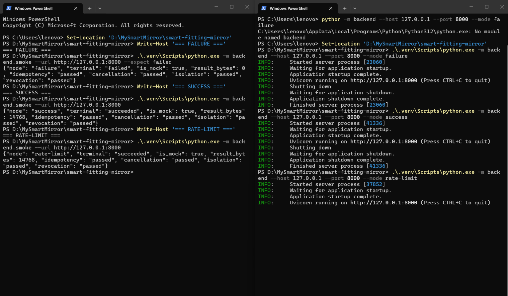
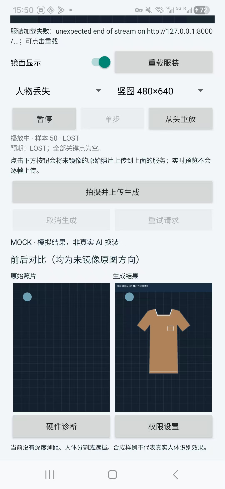
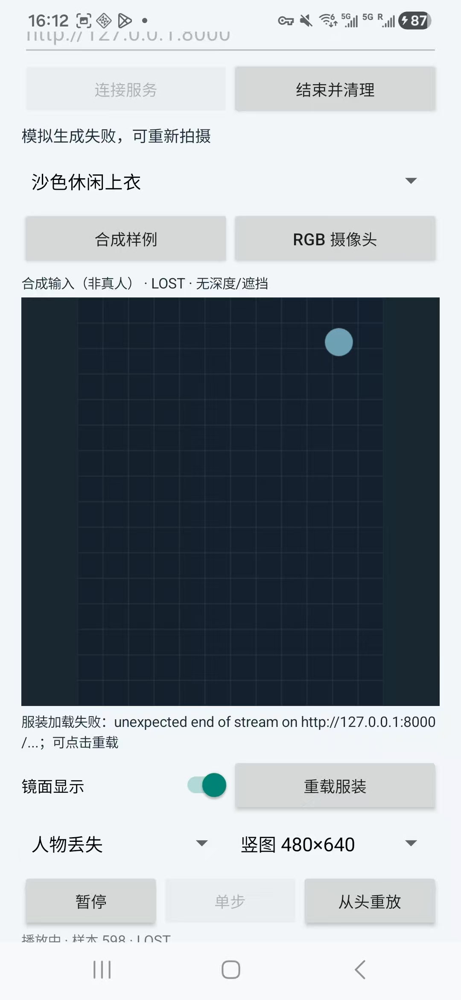

# haiyangniu191-design 第 6 周后端与 Android 网络接手记录

- 执行日期：2026-10-15
- 对应任务：[Issue #5](https://github.com/Miqi9880/smart-fitting-mirror/issues/5)
- 执行人：`haiyangniu191-design`
- 实际测试基线：`d1d2f658190504d82fcb1fc04fdbc1d67d1af075`
- 报告分支基线：`03c721ebad185adeb79b7f46e27d4e07fc10d3ae`

## 本周结论

已完成本周最小交付中的三种模拟服务复现，并在 Samsung SM-S9060 真机上跑通 Android App 到本机 FastAPI 模拟服务的 USB 网络链路。成功模式显示了带 `MOCK` 标记的前后对比结果，失败模式显示了可重新拍摄的失败状态。当前结果只证明本地模拟闭环，不代表真实 AI 换装、人体识别效果、深度设备或企业硬件已经验收。

## 环境

| 项目 | 实测值 |
| --- | --- |
| 开发电脑 | Windows，x64 |
| Python | 3.12.2，仓库根目录 `.venv` |
| 后端 | FastAPI 本地模拟服务 |
| JDK | Microsoft OpenJDK 21.0.12.1 LTS |
| Gradle | 8.11.1 |
| Android SDK | Platform 35、Build Tools 35.0.0、Platform Tools |
| Android Studio | Rabbit 1，build `262.9437.185.2621.16467767` |
| 测试手机 | Samsung SM-S9060，Android 16 / API 36 |
| 手机 ABI | `arm64-v8a, armeabi-v7a, armeabi` |
| 手机显示 | 1080 × 2340，density 450 |
| 连接方式 | USB 调试 + `adb reverse tcp:8000 tcp:8000` |

## 三种模拟服务复现

在仓库根目录使用虚拟环境解释器启动对应模式，再执行 smoke：

```powershell
.\.venv\Scripts\python.exe -m backend --host 127.0.0.1 --port 8000 --mode success
.\.venv\Scripts\python.exe -m backend.smoke --url http://127.0.0.1:8000
```

将 `--mode` 分别替换为 `failure` 和 `rate-limit` 后重复检查。

| 模式 | 终态 | 结果 | 附带检查 |
| --- | --- | --- | --- |
| `success` | `succeeded` | 通过，返回 14768 bytes 模拟结果 | 幂等、取消、隔离、撤销均通过 |
| `failure` | `failed` | 通过，按预期返回失败 | 幂等、取消、隔离、撤销均通过 |
| `rate-limit` | `succeeded` | 通过，经历限流后恢复并返回 14768 bytes | 幂等、取消、隔离、撤销均通过 |



此外，本机执行后端测试共 35 项通过。Android 构建、单元测试和 Lint 已通过；这些结果是在上述实际测试基线完成，报告创建后未把文档更新误记为重新执行代码测试。

## Android 真机调用链

本次真机联调链路如下：

```text
TryOnActivity（页面）
  → TryOnModel / FittingSession（任务状态）
  → HttpFittingApi（HTTP 请求）
  → adb reverse tcp:8000 tcp:8000（USB 端口转发）
  → Python + FastAPI 本地模拟服务
  → 上传原图 / 创建任务 / 轮询状态 / 下载结果
  → Android 页面显示原图与 MOCK 结果
```

真机使用 `http://127.0.0.1:8000`；`10.0.2.2` 仅供 Android Studio 官方模拟器访问宿主电脑。

### 网络错误与状态接手表

| 场景 | 当前处理 | 本周核验 |
| --- | --- | --- |
| `401 SESSION_INVALID` | 清空原图/结果和当前任务，关闭本地会话，提示重新连接；不继续使用旧令牌 | `FittingSession.fail` 代码检查，后端 smoke 覆盖令牌撤销后返回 401 |
| `429` / 可重试错误 | 读取 `Retry-After`，同一请求最多自动尝试 3 次；无响应头时按 1、2、4 秒退避，单次等待超过 60 秒交给用户重试 | rate-limit smoke 通过；SM-S9060 真机仪器测试验证首次 429 后恢复成功 |
| 创建任务响应未知 | 同一次生成保留原 `uploadId`、`garmentId` 和幂等键，重试时不另建计费任务 | `HttpFittingApiTest` 与 `FittingSessionTest` 已覆盖稳定 key；三模式 smoke 的幂等检查通过 |
| 取消与完成竞争 | 以服务端最先进入的终态为准；完成先胜出时仍接受成功，取消先胜出后不再产生结果 | 后端竞态测试及 SM-S9060 真机取消流程通过 |
| 结束会话/页面销毁 | 先使本地版本失效并清零图像，停止轮询；远端删除失败不伪装成已删除，进程退出只做最长 10 秒撤销尝试，TTL 作为后备 | SM-S9060 验证结束后不显示迟到结果，测试完成后临时服务与端口转发均已清理 |
| 普通网络错误或 `5xx` | 有上限退避；仍失败时进入可见错误态并暴露对应重试动作，不把失败显示成成功 | JVM 网络测试覆盖；本周真机运行未人为断开 USB/网络制造该场景 |

### 成功模式

成功流程显示了“`MOCK · 模拟结果，非真实 AI 换装`”，并展示合成输入原图和静态演示上衣结果。



### 失败模式

失败流程显示“模拟生成失败，可重新拍摄”，证明 App 能显示模拟后端的失败终态，而不是把失败伪装为成功。



### SM-S9060 真机回归

2026-10-15 在已解锁并保持前台的 Samsung SM-S9060 上启动 `success`、`failure`、`delayed`、`rate-limit` 四个本地服务，将 8000–8003 端口通过 ADB reverse 转发到手机，并执行：

```powershell
.\gradlew.bat --no-configuration-cache `
  -Pandroid.testInstrumentationRunnerArguments.fitting_test_host=http://127.0.0.1 `
  :app:connectedDebugAndroidTest --console=plain
```

结果为 9 项测试、0 失败、0 错误、0 跳过，耗时 23.963 秒，Gradle `BUILD SUCCESSFUL`。测试覆盖成功/失败、仅预览服装、Activity 重建与后台恢复、取消、429 原请求重试、结束清理以及拒绝迟到结果。原始 XML 位于本机 `android/app/build/outputs/androidTest-results/connected/debug/`，构建结果不提交仓库。

## 已知问题与边界

1. 两张手机截图都出现过 `服装加载失败：unexpected end of stream on http://127.0.0.1:8000/...`。成功结果仍能显示，但服装素材请求存在间歇性断流，需要继续复现并从 Android 日志和后端请求记录定位；本报告不把它描述为完全无异常。
2. 手机截图使用合成输入，不包含真人照片。它能验证页面与网络流程，不能证明真实人体识别、相机效果、遮挡或深度能力。
3. 当前后端 `is_mock=true`，生成结果是静态模拟图片，没有接入真实 AI 提供方、付费模型或生产 HTTPS 服务。
4. 本次没有上传 APK、`.venv`、构建目录、密钥或真人照片。

## 接手理解与下一步

`haiyangniu191-design` 后续维护 `backend` 与 `android/core-network`，不重复实现 `yyyrrrxxx` 负责的 Android 页面。下一步计划：

1. 复现并定位服装素材 `unexpected end of stream`，区分后端连接中断、ADB 转发重连和 Android 客户端读取问题。
2. 与 `yyyrrrxxx` 完成一次同版本模拟联调，记录地址、commit、模式与发现的问题，并在 Issue #5 更新本周状态。
3. 等真实 AI 提供方、鉴权方式和数据留存要求确认后，在后端适配真实生成接口；密钥不进入 APK 或 Git。

