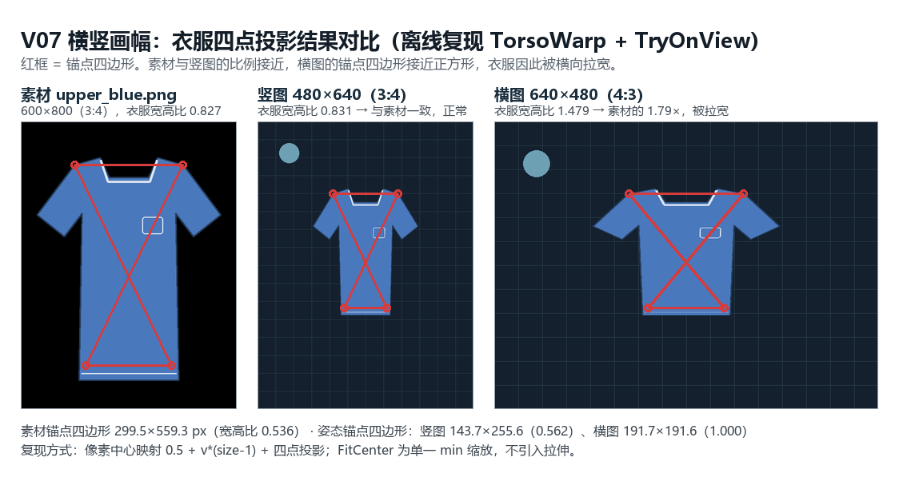

# 第 6 周工作报告 · lyf-bee（实时服装渲染）

日期：2026-10-11。Issue：[#6](https://github.com/Miqi9880/smart-fitting-mirror/issues/6)。
基线：`main` @ `d1d2f65`（串联 Android 实时上衣预览与模拟生成完整流程 #11）。

本轮只使用**合成素材与 Python 合成姿态模型**，未构建 Android、未接真实摄像头、未跑模拟器仪器测试、未接真实 AI。脚本不调用 Kotlin 渲染器，不绘制服装，也不验证帧生命周期。结论不能替代 Android 场景验收或外推为真人效果、设备性能。

## 1. 本周任务回顾 D1–D7

| 日期 | 任务 | 产出 | 状态 |
| --- | --- | --- | --- |
| D1 | 环境跑通 | 可运行的 Python + Pillow 检查环境；Android 环境/构建待补 | 部分完成 |
| D2 | 读 vision.md，确认坐标与锚点约定 | 约定摘录（本文第 3 节） | 完成 |
| D3 | 三件 PNG 素材与四锚点核对 | 12 个锚点全部落在衣服上 | 完成 |
| D4 | V01–V07 场景预期与检查步骤清单 | 场景清单 + V07 详细表 | 完成 |
| D5 | 编写 `tools/verify_scenes.py` | 7 个 `verify_vNN` 函数；App 内逐场景操作已在模拟器执行 | App 操作完成（V01–V06），V07 未通过 |
| D6 | 执行验证并做反向校验 | Python 检查 7/7 通过，反例可正确失败；App 内 V01–V07 实测完成（第 8 节） | App 操作完成（V01–V06），V07 未通过 |
| D7 | 写给 yyyrrrxxx 的渲染对接说明 | `submit`/`setAsset`/`clear`/`FrameLease` 调用约定 | 文档完成，实际联调待补 |

## 2. D1：环境跑通

| 项 | 值 |
| --- | --- |
| 系统 | Windows（win32） |
| Python | 3.13.14 |
| Pillow | 12.3.0 |
| 仓库基线 | `main` @ `d1d2f65` |

说明：以上是作者记录的执行环境；仓库 `docs/getting-started.md` 约定 Python 3.12 + 仓库根目录 `.venv`。审阅补正后另用 Python 3.12.14 / Pillow 12.3.0 复跑本脚本。该脚本的运行记录不代表整个后端或所有依赖已经支持 Python 3.13；Android 构建、渲染单元测试及模拟器操作仍待作者补充。

## 3. D2：读 `docs/interfaces/vision.md`

据此确认的渲染侧约定：

- 原点左上，x 向右、y 向下；坐标在 [0,1]，像素映射为 `x*(width-1)`、`y*(height-1)`。
- `left/right` 指**被拍摄者的解剖学左右**，不是屏幕左右。正面未镜像图中人物左肩在图像右侧。
- 视觉层输出竖正、未镜像的 canonical 图；显示层统一镜像一次（`x → 1-x`），背景、衣服、视觉数据用同一变换。
- 固定八点：左右肩、肘、腕、髋，每点含 x、y、confidence，无可靠位置为 `null`。
- `tracking_state`：双肩双髋四点齐全且 confidence ≥ 0.5 才为 `tracking`；部分可靠为 `partial`；无可靠人体为 `lost`。
- 四个躯干锚点满足门限才显示衣服，否则隐藏；**首版不沿用旧位置**。
- 当前 mask / depth 均为空，`standing_hint` 恒为 `unknown`，不做距离测量。

## 4. D3–D4：素材锚点与场景清单

### 4.1 三件 PNG + 四锚点核对（D3）

素材：`backend/assets/{upper_blue,upper_preview,upper_sand}.png`，均为 600×800 RGBA 透明背景。

锚点（归一化，解剖学左右，来源 `backend/service.py` `GET /garments` 与 `backend/assets/README.md`）：

| 锚点 | 归一化 | 像素（600×800） |
| --- | --- | --- |
| 右肩 right_shoulder | (0.25, 0.15) | (150, 120) |
| 左肩 left_shoulder | (0.75, 0.15) | (449, 120) |
| 右髋 right_hip | (0.30, 0.85) | (180, 679) |
| 左髋 left_hip | (0.70, 0.85) | (419, 679) |

此表是 `round(v*(size-1))` 取样的像素索引；绘图坐标采用像素中心，另加 0.5。

核对结果：**3 张图 × 4 锚点 = 12 个点，alpha 全部为 255**，全部落在不透明衣服像素上。三图实际尺寸均为 600×800，与声明一致。

髋部取色可区分三种面料（`upper_blue` = RGB(74,120,189)、`upper_preview` = RGB(100,133,101)、`upper_sand` = RGB(176,130,89)），说明髋锚点各自取到对应布料，不是碰巧落在共享底图上。

### 4.2 V01–V07 场景预期与检查步骤（D4）

对齐 `docs/no-device-integration.md` 的场景编号，渲染侧看「衣服跟随 / 隐藏 / 不崩溃」。下表是 **Android 待执行的验收步骤**，不是本 Python 脚本已经测过的界面行为：

| 编号 | 输入（人体状态） | 预期看到 | 怎么检查 | 通过 | 失败 |
| --- | --- | --- | --- | --- | --- |
| V01 站立 | 四点躯干齐全，`tracking` | 衣服定位正确、稳定不漂移 | 量四锚点与人体实际肩髋点偏差 | 偏差 ≤ 阈值且连续稳定 | 偏移、穿模、抖动 |
| V02 左右移动 | 样本 0 / 20 / 60，中心 / 向右 0.1 / 向左 0.1 | 衣服整体平移，无额外缩放 | 对比四点位移与点间距离 | 四点同向等量移动，点间距离不变 | 卡原位、错移或额外缩放 |
| V03 大小变化 | 样本 0 / 40，几何倍率 0.7x / 1.2x | 衣服随躯干缩放，不宣称测距 | 量两端「衣宽 / 肩宽」比值 | 比值保持一致 | 不缩放、比例错、缩放抖动 |
| V04 缺少左肩 | 左肩缺失，其余三点有效 | 降级隐藏，不崩溃，不沿用旧位置 | 看是否仍渲染；查日志降级分支 | 无崩溃，降级明确，无旧锚点 | 崩溃、错位、沿用旧衣服 |
| V05 丢失 | 八点全 `null` | 衣服平滑隐藏，画面干净 | 看是否残留鬼影；渲染循环是否存活 | 及时隐藏且无残留 | 残留悬空、崩溃、卡死 |
| V06 恢复 | 样本 0 / 20 / 40 / 60：tracking → partial → lost → tracking | 隐藏后重新贴合，无旧帧闪回 | 依次单步检查四种状态 | 恢复后正确贴合 | 不出现、停在旧位、多帧抖动 |
| V07 横竖画幅 | 横图 640×480 / 竖图 480×640，镜面开关，旋转屏幕 | 背景与衣服共用等比变换，仅显示时翻转一次 | 分别检查画幅、镜像、屏幕方向 | 映射一致、无拉伸、锚点在界内 | 某画幅变形、整体偏移、重复镜像 |

### 4.3 V07 详细表

同一组 **STILL 人体目标点** 在两种输入画幅下的像素中心映射（`0.5 + v*(size-1)`）；不要与素材本身的肩髋锚点混淆。反算为 `(pixel-0.5)/(size-1)`：

| 锚点 | 归一化 | 竖图 480×640 | 横图 640×480 | 归一化反算（横/竖） | 一致性 |
| --- | --- | --- | --- | --- | --- |
| 右肩 | (0.35, 0.25) | (168.15, 160.25) | (224.15, 120.25) | (0.350, 0.250) | 一致 |
| 左肩 | (0.65, 0.25) | (311.85, 160.25) | (415.85, 120.25) | (0.650, 0.250) | 一致 |
| 右髋 | (0.40, 0.65) | (192.10, 415.85) | (256.10, 311.85) | (0.400, 0.650) | 一致 |
| 左髋 | (0.60, 0.65) | (287.90, 415.85) | (383.90, 311.85) | (0.600, 0.650) | 一致 |

检查要点：

- 横竖两画幅均与原始人体目标点比较，归一化反算误差 < 1e-9；这里只验证坐标往返，不证明 Android 显示变换正确。
- 四个锚点在两种画幅下均落在像素中心范围内（`0.5 ≤ x ≤ w-0.5`，`0.5 ≤ y ≤ h-0.5`）。
- 横竖画幅只改变 `image.width/height`，**不改变**归一化坐标含义；`left/right` 解剖学命名在两种画幅下都不变。
- 显示层镜像（`x → 1-x`）必须对背景、关键点、衣服施加**同一次**变换，否则横画幅下会暴露单层裁剪或一像素偏移。

## 5. D5–D6：`tools/verify_scenes.py`

新增文件：`tools/verify_scenes.py`。
仅依赖 Pillow，不需要摄像头、模拟器或后端服务。**只读**：不修改任何素材或仓库文件。

### 5.1 接口

- `verify_v01` … `verify_v07`：每个场景一个函数，返回 `SceneResult(scene, title, passed, reason, details)`，即「通过/失败 + 原因」。
- `run_all(assets_dir, verbose)`：依次跑七个场景并输出总结；全通过 exit 0，有失败 exit 1。
- 命令行：`python tools/verify_scenes.py [--assets backend/assets] [--verbose]`。

Python 模型检查四个躯干目标点是否齐全，以及归一化四边形是否凸、非退化，再用 `0.5 + v*(size-1)` 映射像素中心。现有点默认可靠，**不检查 confidence、不调用 Kotlin、不计算衣服的透视矩阵或绘图**。返回 `None` 只表示该模型不提供目标点，不是实际画面已经隐藏、没有残影或没有旧帧的证据。

### 5.2 执行命令与结果

```powershell
python tools/verify_scenes.py            # 摘要
python tools/verify_scenes.py --verbose  # 逐锚点明细
```

结果：**7/7 Python 素材/几何检查通过，exit code 0**；不是 Android V01–V07 场景全部验收通过。

| 场景 | 结论 | 实测依据 |
| --- | --- | --- |
| V01 站立 | PASS | 三张图 × 4 锚点 = 12 个点 alpha 全为 255 |
| V02 左右移动 | PASS | 在 600×800 测试画幅中，四点共同位移 0 / +59.90 / −59.90 px，纵坐标及点间距不变 |
| V03 大小变化 | PASS | 覆盖 0.7 / 1.2，以及额外 0.5 / 1 / 2 倍率，宽度比匹配输入 |
| V04 缺少左肩 | PASS | Python 四点模型状态为 partial，返回 None |
| V05 丢失 | PASS | Python 四点模型状态为 lost，返回 None；未测试画面残留 |
| V06 恢复 | PASS | Python 模型 partial/lost 返回 None，恢复坐标匹配新姿态（最小位移 29.95 px）；未测帧缓存 |
| V07 横竖画幅 | PASS | 480×640 与 640×480 坐标反算匹配原始输入；镜像、屏幕旋转和实际绘图待验 |

### 5.3 反向校验（证明检查不是形式化的）

| 注入的缺陷 | 预期 | 实测 |
| --- | --- | --- |
| 在 `upper_blue` 左肩锚点打 25×25 透明洞 | V01 失败 | V01 FAIL：`upper_blue/left_shoulder alpha=0 落在透明背景`；exit 1 |
| `--assets` 指向不存在的目录 | 七项全失败 | 7/7 FAIL 且列出缺失素材；exit 1 |

### 5.4 实现中记录的一个坑

四点应沿四边形边界遍历，源点和目标点顺序一致。`TorsoWarp.kt` 当前使用 `left_shoulder → right_shoulder → right_hip → left_hip`，本脚本已对齐；循环换起点也可保持同一边界，不是只有一个起点合法。凸性、边长和面积门限要在归一化坐标中检查，不能改成像素后仍沿用同样门限。

## 6. D7：写给 yyyrrrxxx 的渲染对接说明

供 Issue #7 接入使用；以下以现有 `TryOnView` 实现和公共帧所有权约定为准：

| 主题 | 约定 |
| --- | --- |
| `submit(frameLease, garment)` 顺序 | 在当前会话的 `onFrame` 回调内，每个新帧调一次，**包含 partial/lost 帧**；未选中服装传 `null`；`TryOnView.submit` 内部会 retain 最新帧 |
| `setAsset(garment, bitmap)` | 加载对应服装的 Bitmap 后调用；宽高应匹配 previewImage 声明。Bitmap 所有权转交 View，调用方不能再 recycle；更换素材、clear 或 detach 时 View 负责释放。换衣仅改 submit 的 garment 不会加载图片 |
| `clear()` 时机 | 停止采集 / 会话结束（ENDING、CLOSED）/ 切换数据源 / 页面销毁；幂等可重复调；只清自己的最新帧与素材，不动调用方持有的帧引用 |
| `FrameLease` 所有权 | 回调只借出帧；同步调用 submit 后**不 retain，也不 release 借来的引用**，源会在回调结束释放。自行排队异步使用时才在返回前 retain，并仅对这份引用配对 release；不要自行 recycle 帧 Bitmap |
| 隐藏衣服 | `tracking` 显示；`partial` 与 `lost` 均隐藏，且**不得沿用上一帧位置** |
| 释放帧 | `TryOnView` 管理自己 retain 的帧，替换/clear/detach 时释放；调用方仅释放自己持有的引用，不替源或 View 释放。`latest.acquire()` 借出的独立引用也由实际获取者配对 release |
| 不调 `submit` | 没有新帧、数据源已 stop、旧 sessionId、页面不可见或帧已释放时不提交。**lost 新帧仍要提交**，让背景更新且衣服隐藏；跳过会留下旧 tracking 帧 |

普通 lost 继续提交有图像、无可靠关键点的帧，不调用会同时清素材的 clear；真正停止/切源/结束时才 clear。当前回调在主线程同步 submit，无须增加异步排队。示例：

```kotlin
source.start(sessionId, { borrowed ->
    renderer.submit(borrowed, selectedGarment) // 不 release borrowed
}, { status -> /* 展示状态 */ })
```

## 7. 待办与风险

### 待办

- 本报告与脚本已提交 PR #12，关联 Issue #6；合并仅代表本次阶段性交付通过。
- **V01–V07 已在模拟器 App 内执行完毕（第 8 节）：V01–V06 通过；V07 未通过，单列跟踪**——横图画幅下衣服被拉宽，根因与复现见第 8.5 节，跟踪 Issue：[#15](https://github.com/Miqi9880/smart-fitting-mirror/issues/15)。
- 修复 V07 横图画幅拉伸（归属 `feature-tryon` 渲染几何，候选方向见 8.5，待评审）。
- 补跑 Android 构建、`:feature-tryon:testDebugUnitTest`、`:feature-tryon:lintDebug` 并正式记录；与 yyyrrrxxx 做一次真实模块联调。
- 将 V01–V07 验证接入 CI（当前仅本地可跑）。
- 素材加载/释放约定已补入第 6 节，实际 Android 生命周期行为仍需验证。
- 待 Miqi9880 提供真实 RGB 输入后，用同一套场景在真机上复跑。

### 风险

| 风险 | 影响 | 应对 |
| --- | --- | --- |
| 验证只覆盖合成素材与合成几何 | **不能**作为真实人体精度、真实试衣效果、设备性能证据 | 文档已显式声明；真机验收另行安排，不拿本结果替代 |
| 无深度 / mask，`standing_hint` 恒为 `unknown` | 无遮挡、无距离测量；手臂与躯干无法区分 | 保持 `null`/`unknown`，不伪造；企业设备到位后再验 |
| 四点透视 ≠ 真实布料形变 | 抬手、轻转身的形变可能不自然 | 首版声明为整件四点形变；后续按真机结果迭代 |
| 异步消费易漏 `release` | 帧引用不归零 → 泄漏或崩溃 | 对接说明明确 retain/release 配对规则；建议加引用计数自检 |
| 本地环境与仓库文档不一致 | 复现时可能对不上（Python 3.13 vs 3.12） | 保留作者环境记录及审阅时 3.12 脚本复核；不把它作为完整后端兼容性结论 |

---

### 本周结论

本次完成素材/几何工具与对接文档的阶段性交付：三件素材 12 个锚点落在衣服上，七项 Python 检查通过，透明洞和素材缺失反例会失败。**仍待完成**：作者本地 Android 环境与渲染构建/测试、App V01–V07 实际操作及模块联调；真实人体跟随、抬手形变自然度、深度遮挡、企业设备性能与长时间稳定性也未验证。Issue #6 保持打开。

---

## 8. 模拟器实操验证（补充）

### 8.1 环境

| 项 | 值 |
| --- | --- |
| 模拟后端 | 本地 Uvicorn，`127.0.0.1:8000` |
| Android 模拟器 | Medium Phone，API 37.0 |
| App | 安装于模拟器，连接本地服务 |

App 装在模拟器上并连上本地服务后，逐个切换场景，观察渲染行为。

### 8.2 逐场景观察

| 场景 | 观察结果 |
| --- | --- |
| 合成示例 | 衣服跟随人体 |
| 综合演示 | 衣服正常渲染 |
| 左右移动 | 衣服跟随平移 |
| 大小变化 | 衣服跟随缩放 |
| 缺少左肩 | 衣服隐藏 |
| 丢失 | 衣服隐藏 |
| 恢复 | 衣服重新出现 |
| 横图 640×480 画幅 | 衣服被拉宽，横向拉伸 |
| 竖图 480×640 画幅 | 衣服正常，贴合 |

对应关系（便于与第 4.2 节的 V01–V07 比对；`docs/no-device-integration.md` 中「综合演示」默认为左右移动、周期样本 60–69 丢失；画幅由第二个下拉框切换，不属于场景）：

| App 场景 | 对应编号 |
| --- | --- |
| 合成示例 | V01 站立 |
| 综合演示 | V02 左右移动 |
| 左右移动 | V02 左右移动 |
| 大小变化 | V03 大小变化 |
| 缺少左肩 | V04 缺少左肩 |
| 丢失 | V05 丢失 |
| 恢复 | V06 恢复 |
| 横图 / 竖图画幅（第二个下拉框） | V07 横竖画幅 |

### 8.3 结论

**V01–V06 通过**：在模拟器里的行为与 Python 脚本验证一致。

**V07 未通过**：竖图 480×640 画幅下衣服正常、贴合；**横图 640×480 画幅下衣服被拉宽，横向拉伸**。

这是**渲染层需要修的问题，不是测量问题**：归一化坐标本身没有错，失真发生在衣服的实际绘制结果上。

注：第 5.2 节的 V07 PASS 只表示归一化坐标往返换算正确（Python 素材/几何层面），与本节 App 内实测未通过不矛盾；两项结论的适用范围不同。

### 8.4 未验证

- 真实摄像头输入
- 深度遮挡
- 设备性能（帧率、内存、长时间稳定性）

本节只记录合成样例在模拟器上的界面行为，**不能**作为真实人体识别精度、真实试衣效果或设备性能的证据；`mask` / `depth` / `distance_m` 仍为空，`standing_hint` 仍为 `unknown`。

### 8.5 复现与根因

复现方式：`FitCenter` 使用单一 `min` 缩放，不引入拉伸；因此可以在帧空间离线重放 `TryOnView` 的绘制数学——归一化像素中心映射 `0.5 + v*(size-1)` + 四点投影（等价 `Matrix.setPolyToPoly`），素材 `upper_blue`，静止人体姿态。结果与模拟器观察一致。

| 画幅 | 渲染后衣服 alpha bbox | 宽高比 | 相对素材 |
| --- | --- | --- | --- |
| 竖图 480×640 | 236×284 | 0.831 | 1.005×，与素材一致 |
| 横图 640×480 | 315×213 | 1.479 | **1.789×，横向拉宽** |

素材（600×800）alpha 范围 515×623，宽高比 0.827。



**根因**：失真来自锚点四边形的**长宽比不匹配**，投影映射本身是忠实的：

| 四边形 | 宽 × 高（px） | 宽高比 |
| --- | --- | --- |
| 素材锚点（600×800 画布） | 299.5 × 559.3 | 0.536 |
| 姿态锚点 · 竖图 480×640 | 143.7 × 255.6 | 0.562 |
| 姿态锚点 · 横图 640×480 | 191.7 × 191.6 | 1.000 |

归一化锚点按 x、y 分别映射到 `(width-1)`、`(height-1)`，同一组归一化四边形的像素宽高比因此与**画幅长宽比成正比**；四点投影会把素材四边形拉成目标四边形的形状。合成样例下拉伸倍数 = 画幅长宽比 ÷ 素材画布长宽比 = (4/3) ÷ (3/4) = 1.778，与实测 1.789× 一致（差值来自边界取整）。

**推论**：衣服素材按 3:4 画布设计，只有在 3:4 画幅下不变形；任何其它画幅都会出现同比例拉伸。该机制与输入来源无关（真实摄像头下拉伸倍数由真人姿态四边形与素材四边形之比决定），所以这是渲染几何问题，不是测量或坐标换算问题。

**候选修复方向（待评审，本次未改代码）**：在 `feature-tryon` 渲染侧对目标四边形按素材画布长宽比做等比补偿；或在数据源/素材约定侧统一长宽比基准。选哪一侧超出本报告范围，需与模块负责人评审后定； Issue 正文见 [#15](https://github.com/Miqi9880/smart-fitting-mirror/issues/15)。
