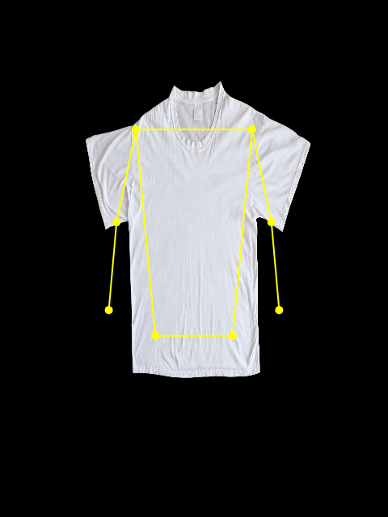
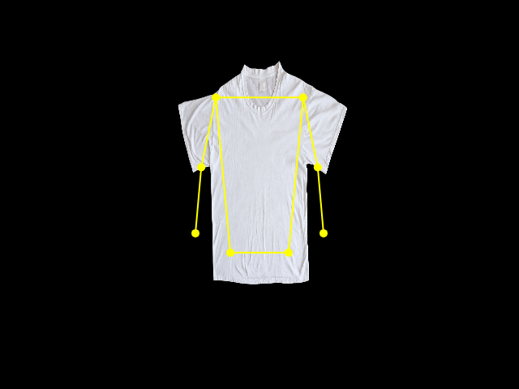
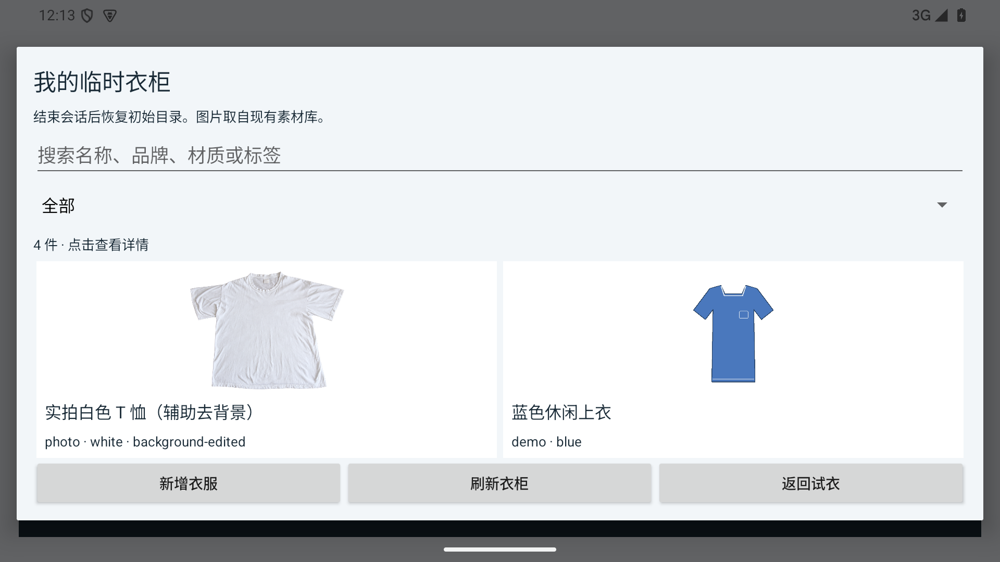

# 完整可用模块迁移验证记录

2026-10-19。由负责人委托 Codex 实现和验证，非成员共同验收。[功能覆盖](../reference-full-migration.md)、[课程复用归属](../../third_party/SmartMirror/NOTICE.md)。

本轮基线 main `0db06f4055a54c77a33dc58813fd08b4c1538d61`，实现分支 `feat/reference-feature-migration`。目标是把上游已有可运行软件功能接入当前工程，并补齐对其他成员有用的联调能力；不是整包复制占位代码。

## 实际环境

Windows、JDK 21.0.10、项目 Gradle Wrapper 与 SDK 35；Android 15 / API 35 / x86_64 模拟器。后端使用项目现有 Python 3.12 虚拟环境。四个本机服务为 8000 success、8001 failure、8002 delayed、8003 rate-limit；模拟器访问 `10.0.2.2`。相机另用获许可的 Pexels 6311639 静态真人照片注入前置输入，未使用实物镜子。

## 初轮发现及修正

- Android 衣柜页的 `filters` 与 TextView 自身属性发生名称冲突，使用明确外部接收者后修正编译。
- 新增可选详情需要合同同步；旧 JSON 样例的双向映射也验证了默认空 details 必须省略，已保留旧样例兼容性。
- 本机旧 pytest 临时目录无权限，改用本轮独立 `--basetemp`，未删除用户临时目录。
- V07 仪器用例仍要求横竖图的归一化点相同；改为检查实际像素宽高比与状态，符合修正后的输入语义。
- 首次四服务测试将 8002/8003 的 delayed/rate-limit 配反，取消测试在已成功任务上等待取消。纠正本轮自建服务配置后重跑，未把该配置问题当作产品缺陷修改终态规则。
- 首次 Android CI 的新增断流用例在第二次请求选到了 `localhost/::1`，而 MockWebServer 未监听该地址；完整失败报告已核对。将测试服务与URL同时固定为127.0.0.1，并断言首个请求确已送达，专门验证中途断流与下次加载恢复；不改变生产端任务重试策略。

## 最终验证

| 检查 | 已核对结果 | 证据范围 |
| --- | --- | --- |
| 后端 pytest | 46 项通过，0 失败/跳过 | 原真实 loopback HTTP、合同/状态机；新增衣柜 CRUD/隔离/无效字段/在途任务快照、SQLite 重开与空目录持久化 |
| JVM | 55 项通过 | core-contracts 15、core-vision 18、core-network 14、feature-tryon 8；含新详情兼容、V07、网格驱动、毫米深度、断流及目录重试 |
| Android App 完整套件 | 17 项通过，0 失败/跳过 | 原四服务 HTTP 流程、RGB 回调/恢复、绘制/原图不变、关键点/OBJ/lost、深度只裁衣服、HOME 解析、设备信息、原生衣柜增删改和 V07 |
| Android core-vision | 6 项通过，0 失败/跳过 | 回放/横竖比例/原图尺寸、停止和会话释放 |
| 衣柜/V07 后续针对性重跑 | 2 项通过 | 布局修正后重跑原生界面搜索/详情/新增/编辑/删除；V07 增强四锚点与镜像断言，并导出截图/数值 |
| 四个 Android 模块 lint | 0 错误 | app 27、core-vision 7、core-network 0、feature-tryon 3 条警告；含既有依赖/写法提示及绘制分配建议，未把警告说成没有 |
| App debug 与测试包构建/安装 | 通过 | API 35 模拟器；最终 APK 校验值见机器证据 |
| 合同/链接 | 通过 | HTTP OpenAPI 0.1.1、视觉/能力两个 Schema、15 个样例、5 个拒绝样例、本地文档链接与 diff 空白检查 |

完整检查使用 `:app:assembleDebug :core-contracts:test :core-vision:testDebugUnitTest :core-network:testDebugUnitTest :feature-tryon:testDebugUnitTest`、四模块 `lintDebug`，以及传入 `-Pandroid.testInstrumentationRunnerArguments.fitting_test_host=http://10.0.2.2` 的 `:app:connectedDebugAndroidTest :core-vision:connectedDebugAndroidTest`。App 整套 17 项与视觉 6 项均通过；该次聚合命令最终因测试类误用 RequiresApi 而由 lint 判失败，按 lint 要求仅保留 SdkSuppress 后单独 lint 成功。后续仅修改衣柜布局/排序，对相关 ReferenceCatalogTest 两项和 App 构建/lint 重新通过；不声称每次历史命令都成功。

中间一轮 App 运行异常延长到约 57 分钟，四个流程在连接阶段超时；本机 HTTP 正常，未确认该长间隔的根因。随后同实现独立重跑四流程＋衣柜/V07 六项通过，再运行整套 17 项通过，最终相关两项也通过。保留该历史，目标设备长时间稳定性仍需单独验证。

后端测试使用独立 `--basetemp`，最终 46 项无失败。SQLite 自带标准库，不引入额外数据库服务。机器摘要及逐项用例名见 [证据 JSON](evidence/reference-full-migration-2026-10-19.json)。

## V07 与页面实测

同一 `real_white_tee`、同一像素比例的合成人体，实际从 HTTP 下载 PNG 后在 TryOnView 绘制：

| 画幅 | 可见衣服边界跨度（右−左 × 下−上） | 比例 | 四锚点最大误差 |
| --- | --- | --- | --- |
| 480×640 | 277×367 | 0.7547684 | 0.00003052 px |
| 640×480 | 208×275 | 0.75636363 | 0.00003052 px |

边界从黑底渲染图中 R>40 的可见像素计算，不是原 PNG alpha 统计；少量比例差来自像素栅格化。镜像后的边界按 `width−1−x` 检查、容差 2 px。没有修改 TorsoWarp 增加画布比例补偿。

两图无真人，衣服来源/辅助处理见 [素材说明](../../backend/assets/real/README.md)；数值为 [竖图](evidence/reference-v07-portrait.json)、[横图](evidence/reference-v07-landscape.json)。这些证据可验收 #15 的几何回归，不代替真人效果。

页面另在 1080×2400、1920×1080/160 dpi 与 1920×1080/320 dpi 观察。高密度横屏发现固定高度列表挤掉底部按钮，改用剩余高度与固定操作行；复核“新增衣服／刷新衣柜／返回试衣”均完整可点击。仅调整本轮自建模拟器的显示覆盖，检查后已恢复，没有修改目标设备。

## 实际完成与保留项

可运行的软件迁移与接入已落地，四人接手从验证/修正开始，不重做既有页面、目录或渲染。真实摄像头品牌/接口/SDK、目标 ZC-3588A 安装与 ABI、真人运动贴合、实际深度、真实 AI、帧率/长期稳定性和共同联调均未据此验收。辅助去背景素材也未冒充纯手工保真完成。设备信息枚举仅提供核对资料，不推断已经出图或支持深度。
