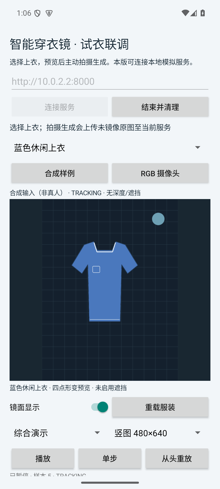
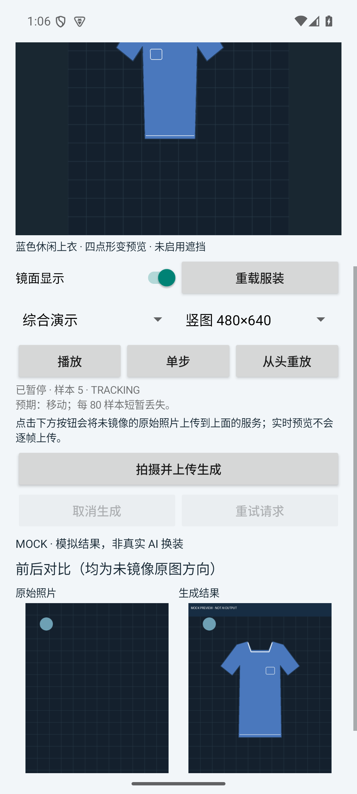
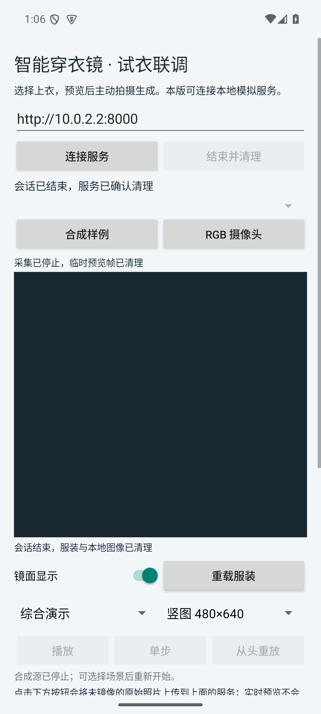

# 首版 Android 模拟试衣验证

日期：2026-10-09。实施/自审：Miqi9880 委托的 Codex；后续维护人见 [交接清单](task-handoff.md)。适用范围是本地模拟后端与合成输入，不代表真实 AI、真实人体效果或企业深度设备已通过。

## 环境与结果

Windows 主机，JDK 21.0.10、Gradle 8.11.1、SDK 35；API 35 Pixel 6 模拟器、SwiftShader、前后摄像头均为模拟。Python 3.12，本地四个 CLI 服务 success/failure/delayed/rate-limit。依赖下载使用可选的 Google Central 镜像；CI 默认使用官方仓库。

| 检查 | 实际结果 | 能证明什么 |
| --- | --- | --- |
| Android debug APK 构建 | 通过 | 各模块和主页面可编译装配 |
| core-contracts | 14 项 JVM 测试通过 | 合同、类型、帧所有权基线 |
| core-vision | 9 项 JVM 测试通过 | 姿态映射和合成场景 |
| core-network | 12 项 JVM 测试通过 | HTTP 编码/鉴权/边界、重试幂等、取消竞争、清理失败 |
| feature-tryon | 4 项 JVM 测试通过 | 归一化四点几何、画幅、丢失与退化情况 |
| app + core-vision 仪器测试 | 15 项通过、0 跳过 | 原有 10 项视觉检查 +1 项像素渲染 +4 项真实本地 HTTP App 流程 |
| 各 Android 模块 lintDebug | 0 errors | 有依赖更新、绘制分配和平台控件等警告；不等同无性能问题 |
| 模拟后端 | PR #9 已交付 35 项通过记录 | 服务合同/隔离/清理/CLI；本次未修改服务逻辑 |

完整复现命令、四个服务端口及必须提供的 fitting_test_host 参数见 [联调说明](tryon-integration.md)。未配置真实服务测试参数时四项用例会跳过，不应拿这种结果替代本表。测试 XML 位于各模块 build/test-results 与 build/outputs/androidTest-results，构建产物不提交到 Git。

## 本轮检查的行为

- 成功：连接→目录/透明素材→选衣→原始拍照上传→生成→下载→明确标注 MOCK 的对比；只预览的绿色上衣禁用生成。
- 异常：failure 返回可见失败和重新拍摄入口；rate-limit 429 后原请求重试；delayed 中 Activity 重建和后台返回保留同一任务；取消后清理；结束后不展示迟到结果。ActivityScenario.recreate 验证重建，不替代真实大屏横竖方向的视觉检查。
- 生命周期：结束前保存的原图/结果数组在清理后为零，ImageView 清空；配置重建后已结束状态不重开采集。远端删除失败不报告已成功删除，保留重试；进程退出仅有界尝试撤销，TTL 仍可能是最终清理方式。
- 绘制：像素检查衣服覆盖、图像/衣服整体镜像、暂停时换衣、lost 隐藏、旧帧释放和素材回收；几何测试另覆盖 partial/错误四边形。
- 代码审查：拍照等待期间禁用选衣，避免拍摄意图变化；摄像头出错清掉旧预览并禁用拍摄；同来源鉴权图片下载，不跟随重定向；release 禁止明文 HTTP。

第一次全量仪器运行中，旧诊断页的窗口焦点断言失败。排查发现测试 AVD 中预装短信应用的 ANR 弹窗占据焦点；关闭该测试环境应用后，完整 15 项通过。诊断用例也改为有上限地等待焦点，仍会在旧弹窗持续占焦点时失败，并未删除该断言。

## 仍需同学完成的验证

真实 RGB 人体、目标大屏交互、设备 SDK/双流同步/对齐、深度遮挡、跟随抖动、美观、真实 AI 及实际输入要求、企业设备 FPS/内存/发热和 8–12 小时稳定性尚未完成。普通模拟器的相机推理成功不代表真实人像准确；首版整件四点变换不等同真实布料形变。

对首次协作成员的要求仍是先复现并理解基线、提交本人的检查或一个小改进，按 [第 6–18 周安排](semester-plan.md) 逐步扩展，不重复实现已有模块。

## 界面与安装包证据

截图来自 API 35 模拟器、合成几何输入和本地 success 服务；为便于检查已暂停输入。它们证明界面装配与清理，不是真人试衣效果图。最后修正了系统栏覆盖滚动内容及结束后旧跟踪文字的问题，并重跑成功流程（1 项重复验证通过）。

| 实时预览 | 原图与模拟结果 | 结束清理 |
| --- | --- | --- |
|  |  |  |

本地交付 APK：`smart-fitting-mirror-debug.apk`，versionName `0.2.0-mock` / versionCode `2`，90,174,578 bytes。SHA256：`357E0ADE3AAC866434FD4019C60853DBA0EBF4CF0FDB5B368123094107CEB945`。这是本机构建产物的指纹；其他机器/CI 重新构建的 debug 签名可能不同。APK 和演示录像交付给负责人，不把二进制安装包或录像提交到源码仓库。
